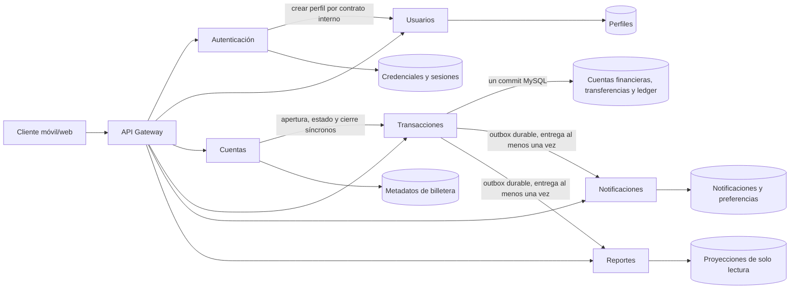

# PayFlex Backend

## Límites y comunicación



Cada proceso selecciona un módulo con `SERVICE_NAME=auth|users|accounts|transactions|notifications|reports|gateway`. `SERVICE_NAME=all` monta todos los routers para desarrollo y no representa el despliegue aislado. Los servicios se comunican mediante HTTP interno con `x-internal-service-token`; los clientes externos deben pasar por el gateway.

El MCP es un proceso cliente separado (`dist-mcp/main.mjs`), con transporte stdio por defecto o Streamable HTTP mediante `--http`. Stdio usa `PAYFLEX_ACCESS_TOKEN`; HTTP verifica cada JWT consultando `/users/me` y deriva el principal del perfil, nunca de argumentos MCP. HTTP exige Redis para borradores/locks y límites de usuario/IP. El perfil Compose `mcp` solo publica en loopback para desarrollo. En remoto debe estar detrás de un proxy TLS confiable y usar `MCP_PUBLIC_URL` HTTPS, hosts/orígenes exactos y Redis privado protegido.

Las tablas viven en un esquema MySQL común para simplificar el entorno de curso, pero el código limita la escritura por módulo y los cambios financieros solo los realiza Transacciones. En un despliegue real, asigna una cuenta MySQL distinta por servicio con permisos mínimos: Auth sobre credenciales/sesiones/recuperación/intentos; Usuarios sobre perfiles; Cuentas sobre metadatos de billetera; Transacciones sobre cuentas financieras, transferencias, ledger y outbox; Notificaciones sobre preferencias/avisos/eventos procesados; Reportes sobre proyecciones/eventos procesados; Gateway sobre buckets de rate limit. Ningún permiso de UPDATE/DELETE debe darse a la tabla `ledger_entries`.

## Consistencia financiera y eventos

El importe HTTP es una cadena decimal de hasta dos posiciones; la lógica lo convierte a `bigint` en centavos. MySQL usa `DECIMAL(18,2)`, restricción de saldo no negativo y moneda `GTQ`. La transferencia bloquea emisor y receptor en orden ascendente de ID, valida propietario/estado/saldo y escribe saldo, transferencia, ambos asientos y outbox dentro de la misma transacción InnoDB. Un fallo hace rollback completo. La clave `Idempotency-Key` se liga al hash del usuario emisor, receptor, importe y moneda.

Contrato `transfer.confirmed` persistido en `outbox_events`:

```json
{
  "eventId": "uuid",
  "transferId": "uuid",
  "senderId": "wallet-uuid",
  "recipientId": "wallet-uuid",
  "senderUserId": "user-uuid",
  "recipientUserId": "user-uuid",
  "amount": "12.30",
  "currency": "GTQ",
  "createdAt": "2026-01-01T12:00:00.000Z"
}
```

El publicador reintenta hasta que ambos consumidores acepten el evento. Cada consumidor guarda `(consumer,eventId)` en la misma transacción que su efecto, por lo que las reentregas no duplican avisos ni filas de reporte. Los fallos de consumo nunca cambian el resultado financiero confirmado. Los reportes son eventualmente consistentes e incluyen `dataAsOf`; las billeteras consultan el saldo autoritativo a Transacciones.

Notificaciones expone el canal `in_app`; no hay proveedor externo seleccionado. Recuperación por correo requiere SMTP configurado. No se registra ni se devuelve el token de recuperación en respuestas o logs.

## Arranque

Requisitos: Node.js 22+, npm y MySQL 8.4. Configura `.env` a partir de `.env.example`; usa secretos distintos y aleatorios para JWT, llamadas internas y cifrado TOTP. Genera un valor aleatorio con:

```powershell
node -e "console.log(require('node:crypto').randomBytes(32).toString('hex'))"
```

Para levantar todos los procesos y MySQL:

```powershell
docker compose up --build
```

El gateway queda en `http://localhost:8080`. Compose inicializa `schema.sql` solo al crear por primera vez el volumen; para aplicar cambios posteriores se requiere una migración controlada. Para ejecución local, aplica el esquema a la base antes de `npm run dev`.

La conexión a MySQL usa `DB_SYNCHRONIZE=false`; no habilites `synchronize` en producción. `GET /health` es liveness y `GET /ready` valida que TypeORM conectó.

## Seguridad y operación

- Usa TLS en un ingress/reverse proxy confiable delante del gateway; el contenedor no termina TLS.
- Configura `CORS_ORIGINS` con orígenes exactos y ajusta `trust proxy` al número/topología real de proxies.
- Gateway usa buckets MySQL compartidos (300 solicitudes por IP/minuto); autenticación limita a 5 inicios de sesión por identificador/ventana de 15 minutos y limita recuperación a 3 solicitudes/hora.
- JWT de acceso dura 10 minutos; refresh aleatorio de 30 días se guarda solo como hash y rota al renovar. Contraseñas usan bcrypt con coste 12; secretos TOTP se cifran con AES-256-GCM.
- Si 2FA está habilitado, cada transferencia requiere `X-2FA-Code`; Transacciones verifica TOTP síncronamente con Auth antes de bloquear o modificar cuentas. Los fallos de verificación tienen límite compartido por usuario.
- Los logs no incluyen cuerpos, contraseñas, tokens ni datos de pago. Configura retención/limpieza para intentos, rate limits, sesiones expiradas y auditoría según política.
- Para producción, usa gestor de secretos/KMS, cuentas MySQL separadas, backups cifrados con prueba de restauración, métricas/alertas y límites de conexión por servicio.
- Este código no constituye certificación PCI-DSS ni sustituye revisión de seguridad, pruebas de penetración, hardening del host o evaluación legal/regulatoria.

## Endpoints

Contrato detallado: [`openapi.yaml`](openapi.yaml). Todos los endpoints de usuario usan `Authorization: Bearer <accessToken>`. Solo Transacciones puede confirmar transferencias; no existen depósitos ni retiros en esta fase.